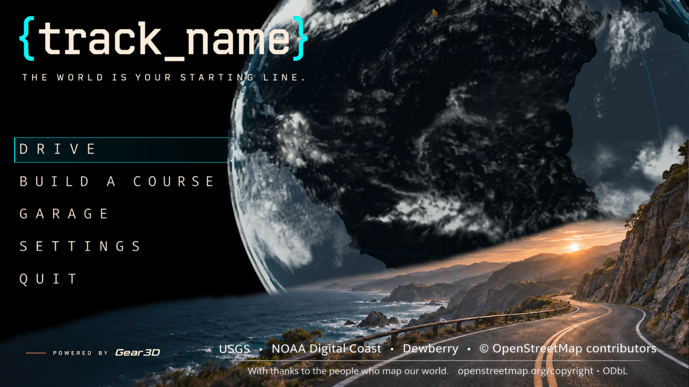

# {track_name} Racing

**The world is your starting line.**

  

**{track_name} Racing** is a racing simulator and course builder powered by **Gear3D**. Real-world terrain, procedural engineering, and an unreasonable amount of attention to what happens under the hood. All of it in service of a good race.

Build the road. Tune the machine. Take the wheel.

Yes, the braces belong there. We named the game.

**[View the image gallery →](https://github.com/thisoldcpu/track_name-Racing/tree/main/images)**

## Serious machinery. Questionable drivers.

Our proving ground is California's Pacific Coast Highway: coastal terrain, winding roads, wildlife, and tiny vehicles with very ambitious occupants.

The engineering is part of the game. Engines, brakes, rotors, and gearboxes have a reason to exist beyond looking convincing. In **Brutal mode**, heat and equipment failures are part of the race. Understanding your machine matters when you push it too far.

The development direction reaches from combustion engines to battery-powered, DC-motor builds. Ted is perfectly capable of modifying an RC car. Whether he should is another question.

## A game you can build in

Gear3D is always a game engine and always an editor. That philosophy runs through {track_name} Racing:

- **Courses worth exploring.** Real-world geography provides the foundation; the course builder makes room for your ideas.
- **Procedural components.** Build the geometry for the things the simulation needs to understand, from road signs to mechanical parts.
- **A cockpit you arrange.** Move, scale, enable, or disable individual UI elements to suit your view.
- **A world beyond the asphalt.** Flocking birds, coastal wildlife, and cameras that let you enjoy more than the racing line.
- **Room to extend it.** Plug-ins, technical documentation, and practical examples for people who want to get their hands dirty.

These describe the project and its development direction. Early Access release notes will identify what is available in each build.

## What this repository is for

This is the public technical companion to {track_name} Racing. **It is not the full source code for the game or Gear3D.**

As development progresses, we will freely publish:

- Plug-ins and integration examples.
- Technical data, documentation, and manuals.
- Research, references, and proofs of concept.
- Test code and reproducible experiments.
- How-to guides explaining how the pieces work and how to build on them.

You do not need to buy the game to read and learn from the material published here. Individual releases will identify their applicable licenses and third-party attribution.

## SignGeometry

Even the speed-limit signs have engineering behind them.

**SignGeometry** builds road-sign geometry procedurally from published specifications. Its sources will be available in a separate repository:

**[Explore SignGeometry →](https://github.com/thisoldcpu/SignGeometry/tree/main)**

## Steam Early Access

| | Plan |
| --- | --- |
| Target launch | **January 1, 2027** |
| Planned price | **US $14.99** |
| Distribution | **Steam Early Access** |

The date is our development target. Follow this repository for technical releases, documentation, and progress toward launch.

---

**Made for people who ask “what happens if…?” and then turn the key.**
